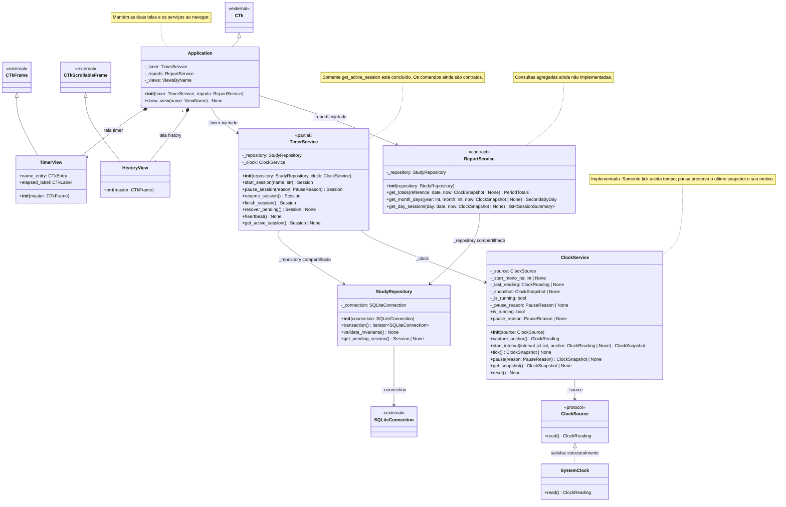
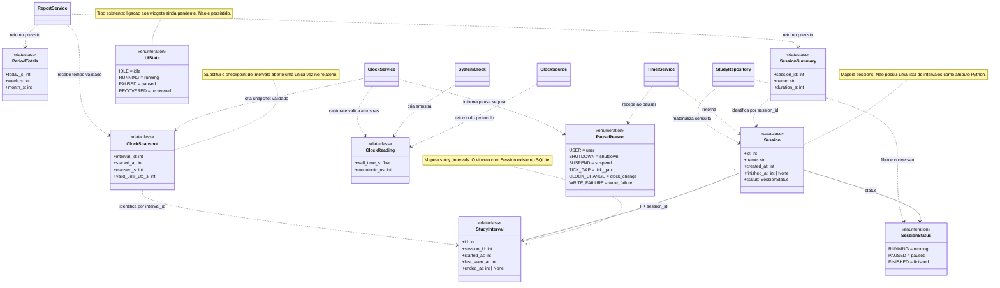
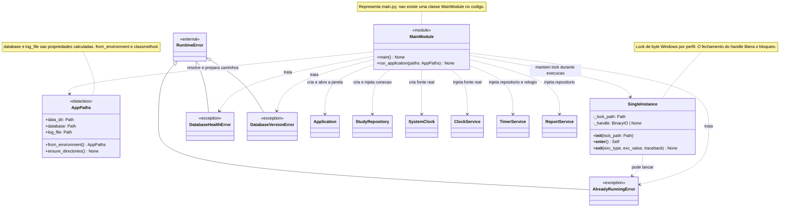

# Diagrama de classes — StudyTimer

Modelo baseado no código atual e nos contratos,
incluindo a revisão de segurança. As três vistas abaixo formam um único modelo
UML: classes repetidas entre vistas representam a mesma classe.

Os diagramas usam Mermaid e podem ser visualizados no GitHub ou em um preview
Markdown com suporte a Mermaid. A notação segue a
[referência de diagramas de classes do Mermaid](https://mermaid.js.org/syntax/classDiagram.html).

## Legenda

| Notação | Significado neste projeto |
| --- | --- |
| `+` / `-` | Membro público / detalhe interno indicado por `_` no código Python. |
| `A <\|-- B` | B herda de A. |
| `A <\|.. B` | B satisfaz a interface de A; pode ser tipagem estrutural. |
| `A --> B` | A mantém uma referência para B. |
| `A *-- B` | A cria e contém B, como as duas telas da janela. |
| `A ..> B` | A usa B em uma assinatura, operação ou referência por identificador. |
| `1` / `0..*` | Exatamente um / zero ou muitos elementos relacionados. |
| `<<dataclass>>` | Modelo imutável com `frozen=True` e `slots=True`. |
| `<<enumeration>>` | Enumeração derivada de `StrEnum`. |
| `<<protocol>>` | Interface Python declarada com `typing.Protocol`. |
| `<<partial>>` / `<<contract>>` | Parte do comportamento ainda levanta `NotImplementedError`. |
| `<<external>>` | Tipo fornecido pelo Python ou pelo CustomTkinter. |
| `<<module>>` | Agrupamento de funções de um módulo; não é uma classe Python. |

Não se usa agregação apenas porque uma dependência foi injetada: referências a
serviços, repositório e conexão são associações. A raiz de composição controla
a criação desses objetos e o fechamento da conexão.

## 1. Interface, serviços e persistência

Abreviações usadas apenas para deixar as caixas legíveis, sem criar novos tipos
ou classes no código:

| Nome no diagrama | Tipo Python real |
| --- | --- |
| `ViewName` | `Literal["timer", "history"]` |
| `ViewsByName` | `dict[str, TimerView \| HistoryView]` |
| `SecondsByDay` | `dict[date, int]` |
| `SQLiteConnection` | `sqlite3.Connection` |

O método `transaction()` é decorado com `@contextmanager`: sua anotação é
`Iterator[sqlite3.Connection]`, mas o chamador o utiliza com `with`.
`SystemClock` não herda explicitamente de `ClockSource`; o método `read()` com
a assinatura compatível satisfaz o protocolo por tipagem estrutural.

Em `ClockService`, `is_running` e `pause_reason` são propriedades somente de
leitura. `start_interval()` aceita `anchor=None` e captura uma âncora quando
ela não for fornecida; `pause()` usa `PauseReason.USER` como motivo padrão.
O getter do snapshot não lê a fonte nem atualiza a contagem. O último snapshot
permanece disponível após uma pausa, para que o serviço de sessão o persista.

As telas atuais ainda não recebem serviços diretamente. A janela guarda os
serviços e cria os widgets; a ligação dos botões aos comandos será feita na
implementação do cronômetro. Também não existe SQL nos widgets nem dependência
de CustomTkinter nos serviços.

Fontes: [application.py](../app/application.py), [ui/](../app/ui/),
[services/](../app/services/) e [repository.py](../app/database/repository.py).

## 2. Modelos de dados, enumerações e cardinalidades

`StudyRepository` nesta vista é a mesma classe da vista anterior. As dependências
de retorno previstas dos relatórios representam assinaturas já declaradas,
sem indicar que essas consultas estejam funcionando. Os snapshots do relógio
já são produzidos por ticks validados.

A cardinalidade `0..*` representa o esquema SQLite atual: cada intervalo pertence
a exatamente uma sessão, enquanto uma sessão pode existir sem intervalos. O
contrato de início do cronômetro exige criar a sessão e o primeiro intervalo na
mesma transação. O diagrama não adiciona um atributo `intervals` à dataclass.

`ClockSnapshot`, `ClockReading`, `PeriodTotals` e `SessionSummary` são objetos de
transferência em memória, não tabelas SQLite. O resumo representa a parcela de
uma sessão no dia consultado; não contém todos os intervalos dessa sessão.

Fontes: [models/](../app/models/), com uma classe por arquivo, e
[schema.sql](../app/database/schema.sql).

## 3. Composição, configuração, instância única e erros

`main()` mantém o lock durante toda a execução. `run_application()` cria uma
conexão e um repositório compartilhado pelos dois serviços, injeta as dependências
e fecha a conexão no `finally`, depois do encerramento da janela.

Os parâmetros completos de `SingleInstance.__exit__` são
`exc_type: type[BaseException] | None`, `exc_value: BaseException | None` e
`traceback: TracebackType | None`. Foram abreviados apenas na caixa do diagrama.

Fontes: [main.py](../main.py), [config.py](../app/config.py),
[single_instance.py](../app/single_instance.py) e
[health.py](../app/database/health.py).

## Funções de apoio e seus relacionamentos

Esses módulos mantêm funções livres. Não são representados como classes de
serviço inexistentes.

| Módulo | Operações | Dependências e responsabilidade |
| --- | --- | --- |
| [connection.py](../app/database/connection.py) | `initialize_database(database_path: Path) -> sqlite3.Connection` | Usa health e backup; aplica PRAGMAs, cria o esquema inicial e devolve a conexão ao ponto de composição. |
| [health.py](../app/database/health.py) | `validate_connection(connection) -> None`, `validate_database(database_path) -> None`, `preserve_corrupt_database(database_path) -> None` | Usa SQLite; verifica integridade, FKs e versão; pode lançar `DatabaseHealthError` ou `DatabaseVersionError`. Preserva banco e sidecars sem reparar o original. |
| [backup.py](../app/database/backup.py) | `create_backup(connection, backup_dir, keep=5) -> Path`, `restore_backup(backup_path, database_path) -> None`, `_restore_validated_backup(backup_path, database_path) -> None` | Usa health e a API de backup da conexão. A restauração obtém `SingleInstance` e preserva uma cópia do destino antes de alterá-lo. |
| [logging_config.py](../app/logging_config.py) | `configure_logging(log_file: Path) -> None` | Cria `logging.handlers.RotatingFileHandler`: 1 MiB, três arquivos anteriores, sem conteúdo de sessão nos erros de inicialização. |
| [validation.py](../app/validation.py) | `normalize_session_name(name: str) -> str` | Usada por `TimerService.start_session`; remove controles, aplica nome padrão e limite de 120 caracteres. |
| [startup_dialog.py](../app/ui/startup_dialog.py) | `show_startup_message(message: str) -> None` | Usada por `main()`; chama MessageBoxW do Windows para apresentar texto estático sem caminhos privados. |

O repositório mantém apenas a conexão de trabalho. As conexões temporárias de
validação e backup são abertas e fechadas nos próprios módulos de infraestrutura.

## Restrições que acompanham o modelo

| Área | Regra |
| --- | --- |
| Sessão pendente | No máximo uma sessão `running` ou `paused` no banco, garantido por índice único parcial. |
| Intervalo aberto | No máximo um por sessão; `running` exige exatamente um, `paused` e `finished` exigem zero ao validar a transação. |
| Datas do intervalo | `last_seen_at >= started_at`; `ended_at >= started_at`; ao encerrar, `last_seen_at <= ended_at`. |
| Finalização | `finished_at` só existe em `finished` e nunca antecede `created_at`. O contrato ainda pendente deve usar o maior término confirmado dos intervalos. |
| Tempo | Duração por nanossegundos monotônicos; UTC civil é âncora de calendário. O relógio garante `valid_until_utc_s = started_at + elapsed_s` nos snapshots que produz. |
| Tick inseguro | Lacuna monotônica estritamente maior que 5 s pausa com TICK_GAP. Regressão monotônica ou divergência civil estritamente maior que 5 s pausa com CLOCK_CHANGE. O tick rejeitado não é contabilizado. |
| Pausa do relógio | `pause()` não lê a fonte e congela o último tick aceito. O relógio não altera o status no SQLite; essa integração pertence ao serviço de sessão ainda pendente. |
| Estado visual | `idle` não possui sessão pendente; `running` corresponde a sessão running; `paused` e `recovered` correspondem a sessão paused. Integração visual ainda pendente. |
| Relatórios | Somam segundos antes de formatar minutos, dividem intervalos por fronteiras locais e evitam dupla soma do intervalo aberto. Implementação pendente. |
| Persistência | WAL, synchronous FULL, FKs e transações explícitas; SQL parametrizado e validação antes do COMMIT. |
| Dados locais | Banco e logs no perfil LOCALAPPDATA, fora do executável. Backups automáticos validados com retenção de cinco, além das cópias anteriores à restauração com retenção própria. |

## Estado de implementação e extensão do projeto

- **Implementado:** modelos, enumerações, fonte `SystemClock`, relógio com âncora,
  validação de ticks, snapshots e pausa conservadora; consulta de sessão
  pendente, transações e invariantes do repositório, inicialização e saúde do banco,
  backups/restauração, lock de instância, logs e navegação estrutural entre duas telas.
- **Contratos ainda pendentes:** comandos do cronômetro, heartbeat, recuperação de
  sessão, persistência das pausas detectadas pelo relógio, relatórios e integração dos estados
  visuais, modais e calendário.
- **Integração Windows pendente:** eventos de suspensão e retomada devem alimentar
  o fluxo de pausa segura. Ainda não existe uma classe adaptadora para esses eventos;
  este documento não pressupõe sua implementação.
- **Fora do modelo de execução:** testes, CI, geração de hashes e empacotamento
  contêm ferramentas e funções auxiliares, não classes de domínio do aplicativo.
- **Fora do escopo:** login, API, nuvem, telemetria, exportação CSV e criptografia
  própria. Não há classes para essas funcionalidades.

Ao implementar os contratos, atualizar esta documentação junto com o código,
principalmente os atributos de estado do relógio, comandos do repositório e a
ligação dos eventos da interface aos serviços. Ver também
[arquitetura](architecture.md), [segurança](security.md) e [testes](testing.md).
