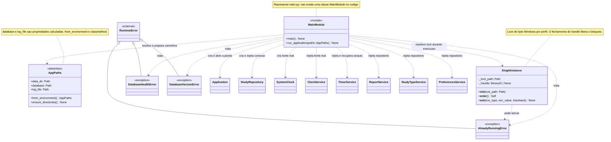

# Diagrama de classes — StudyTimer

Modelo baseado no código atual e nos contratos,
incluindo a revisão de segurança. As três vistas abaixo formam um único modelo
UML: classes repetidas entre vistas representam a mesma classe.

Os diagramas usam Mermaid e podem ser visualizados no GitHub ou em um preview
Markdown com suporte a Mermaid. A notação segue a
[referência de diagramas de classes do Mermaid](https://mermaid.js.org/syntax/classDiagram.html).

## Legenda

| Notação | Significado neste projeto |
| --- | --- |
| `+` / `-` | Membro público / detalhe interno indicado por `_` no código Python. |
| `A <\|-- B` | B herda de A. |
| `A <\|.. B` | B satisfaz a interface de A; pode ser tipagem estrutural. |
| `A --> B` | A mantém uma referência para B. |
| `A *-- B` | A cria e contém B, como as duas telas da janela. |
| `A ..> B` | A usa B em uma assinatura, operação ou referência por identificador. |
| `1` / `0..*` | Exatamente um / zero ou muitos elementos relacionados. |
| `<<dataclass>>` | Modelo imutável com `frozen=True` e `slots=True`. |
| `<<enumeration>>` | Enumeração derivada de `StrEnum`. |
| `<<protocol>>` | Interface Python declarada com `typing.Protocol`. |
| `<<external>>` | Tipo fornecido pelo Python ou pelo CustomTkinter. |
| `<<module>>` | Agrupamento de funções de um módulo; não é uma classe Python. |

Não se usa agregação apenas porque uma dependência foi injetada: referências a
serviços, repositório e conexão são associações. A raiz de composição controla
a criação desses objetos e o fechamento da conexão.

## 1. Interface, serviços e persistência

```mermaid
classDiagram
    direction TB

    class CTk {
        <<external>>
    }
    class CTkFrame {
        <<external>>
    }
    class CTkScrollableFrame {
        <<external>>
    }

    class Application {
        -_timer: TimerService
        -_reports: ReportService
        -_types: StudyTypeService
        -_preferences: PreferencesService
        -_appearance: AppearanceMode
        -_type_dialog: StudyTypeDialog | None
        -_power: WindowsPowerMonitor
        -_history_view: HistoryView
        -_history_selection: HistorySelection
        -_history_parent: HistorySelection | None
        -_date_picker: DatePicker | None
        -_visible_view: ViewName
        -_views: ViewsByName
        -_timer_view: TimerView
        -_session: Session | None
        -_state: UIState
        -_elapsed_s: int
        -_failed: bool
        -_closed: bool
        -_tick_job: str | None
        -_heartbeat_job: str | None
        -_recovery_job: str | None
        +__init__(timer: TimerService, reports: ReportService, types: StudyTypeService, preferences: PreferencesService)
        +on_create_type() None
        +on_manage_types() None
        +on_appearance(label: str) None
        -_reload_types() None
        -_type_saved(type_id: int | None) None
        +show_view(name: ViewName) None
        +on_period_step(delta: int) None
        +on_period_mode(period: ReportPeriod) None
        +on_type_filter(type_id: int | None) None
        +on_clear_filter() None
        +on_bucket(index: int) None
        +on_history_back() None
        +on_pick_date() None
        +on_day(day: date) None
        +on_today() None
        -_refresh_history() None
        +on_start() None
        +on_pause() None
        +on_finish() None
        +on_close() None
        -_run(command: Command) None
        -_refresh() None
        -_render() None
        -_poll() None
        -_heartbeat() None
        -_show_recovery() None
        -_handle_error(error: Exception) None
    }
    class TimerView {
        +name_entry: CTkEntry
        +elapsed_label: CTkLabel
        +status_label: CTkLabel
        +start_button: CTkButton
        +pause_button: CTkButton
        +finish_button: CTkButton
        +type_menu: CTkOptionMenu
        +new_type_button: CTkButton
        +manage_types_button: CTkButton
        +__init__(master: CTkFrame, on_start: Callback, on_pause: Callback, on_finish: Callback, on_create_type: Callback, on_manage_types: Callback)
        +set_types(types: list~StudyType~) None
        +select_type(type_id: int | None) None
        +get_type_id() int | None
        +get_name() str
        +render(state: UIState, session: Session | None, elapsed_s: int, failed: bool) None
    }
    class CTkToplevel {
        <<external>>
    }
    class StudyTypeDialog {
        -_service: StudyTypeService
        -_selected_id: int | None
        +refresh() None
        +select_type(type_id: int) None
        +clear_selection() None
        +save() None
        +toggle_archived() None
        +close() None
    }
    class HistoryView {
        +report: PeriodReport | None
        +chart: StudyChart
        +period_label: CTkButton
        +total_label: CTkLabel
        +average_label: CTkLabel
        +status_label: CTkLabel
        -_session_rows: list~CTkLabel~
        +__init__(master: CTkFrame, on_step, on_mode, on_day_picker, on_today, on_filter, on_clear_filter, on_bucket, on_back)
        +render(report: PeriodReport, today: date, parent_period: ReportPeriod | None) None
        +refresh_theme() None
        +show_error() None
    }
    class StudyChart {
        +selected_index: int | None
        +__init__(master: CTkFrame, on_select: BucketCallback)
        +render(report: PeriodReport) None
        +refresh_theme() None
        +select_bucket(index: int) None
    }
    class DatePicker {
        +__init__(master: CTk, selected: date, on_select: DayCallback, max_date: date)
        +select_day(day: date) None
        +close() None
    }

    class TimerService {
        -_repository: StudyRepository
        -_clock: ClockService
        -_persistence_failed: bool
        +persistence_failed: bool
        +is_running: bool
        +__init__(repository: StudyRepository, clock: ClockService)
        +start_session(name: str, study_type_id: int | None) Session
        +pause_session(reason: PauseReason) Session
        +resume_session() Session
        +finish_session() Session
        +recover_pending() Session | None
        +heartbeat() None
        +get_active_session() Session | None
        +tick() None
        +freeze(reason: PauseReason) None
        +pause_for_power() None
        +get_elapsed_seconds() int
        +get_snapshot() ClockSnapshot | None
        -_persistence_operation() Iterator~None~
        -_require_active_session(status: SessionStatus) Session
        -_require_stopped_clock() None
        -_freeze_interval(session_id: int, reason: PauseReason) ClockSnapshot
        -_require_snapshot(session_id: int) ClockSnapshot
    }
    class StudyTypeService {
        -_repository: StudyRepository
        +__init__(repository: StudyRepository)
        +list_types(include_archived: bool) list~StudyType~
        +create_type(name: str, color_key: StudyColor) StudyType
        +update_type(type_id: int, name: str, color_key: StudyColor) StudyType
        +archive_type(type_id: int) StudyType
        +restore_type(type_id: int) StudyType
    }
    class PreferencesService {
        -_repository: StudyRepository
        +__init__(repository: StudyRepository)
        +get_appearance_mode() AppearanceMode
        +set_appearance_mode(mode: AppearanceMode) None
    }
    class ReportService {
        -_repository: StudyRepository
        -_timezone_source: TimezoneSource
        +__init__(repository: StudyRepository, timezone_source: TimezoneSource)
        +get_today() date
        +get_period_dates(selection: HistorySelection) LocalDates
        +get_period_report(selection: HistorySelection, now: ClockSnapshot | None) PeriodReport
        +get_totals(reference: date, now: ClockSnapshot | None) PeriodTotals
        +get_month_days(year: int, month: int, now: ClockSnapshot | None) SecondsByDay
        +get_day_sessions(day: date, now: ClockSnapshot | None) list~SessionSummary~
        -_segments(start: int, end: int, now: ClockSnapshot | None) ReportSegments
        -_bounds(first: date, following: date, zone: tzinfo) Bounds
        -_next_month(first: date) date
        -_overlap(start: int, end: int, a: int, b: int) int
    }
    class ClockService {
        -_source: ClockSource
        -_start_mono_ns: int | None
        -_last_reading: ClockReading | None
        -_snapshot: ClockSnapshot | None
        -_is_running: bool
        -_pause_reason: PauseReason | None
        +is_running: bool
        +pause_reason: PauseReason | None
        +__init__(source: ClockSource)
        +capture_anchor() ClockReading
        +start_interval(interval_id: int, anchor: ClockReading | None) ClockSnapshot
        +tick() ClockSnapshot | None
        +pause(reason: PauseReason) ClockSnapshot | None
        +get_snapshot() ClockSnapshot | None
        +reset() None
    }
    class ClockSource {
        <<protocol>>
        +read() ClockReading
    }
    class SystemClock {
        +read() ClockReading
    }
    class StudyRepository {
        -_connection: SQLiteConnection
        +__init__(connection: SQLiteConnection)
        +transaction() Iterator~SQLiteConnection~
        +validate_invariants() None
        +get_pending_session() Session | None
        +get_session(session_id: int) Session | None
        +get_open_interval(session_id: int) StudyInterval | None
        +get_session_intervals(session_id: int) list~StudyInterval~
        +start_session(name: str, started_at: int, study_type_id: int | None) SessionIntervalPair
        +resume_session(session_id: int, started_at: int) SessionIntervalPair
        +pause_session(session_id: int, snapshot: ClockSnapshot) Session
        +finish_session(session_id: int, snapshot: ClockSnapshot | None) Session
        +save_checkpoint(session_id: int, snapshot: ClockSnapshot) None
        +recover_pending() Session | None
        +get_report_intervals(start: int, end: int, active_interval_id: int | None) SessionIntervals
        +get_zero_duration_sessions(start: int, end: int) list~Session~
        +get_period_intervals(start: int, end: int, active_interval_id: int | None) TypedSessionIntervals
        +get_zero_duration_report_sessions(start: int, end: int) TypedSessions
        +get_study_type(type_id: int) StudyType | None
        +list_study_types(include_archived: bool) list~StudyType~
        +create_study_type(name: str, color_key: StudyColor) StudyType
        +update_study_type(type_id: int, name: str, color_key: StudyColor) StudyType
        +set_study_type_archived(type_id: int, archived: bool) StudyType
        +get_appearance_mode() AppearanceMode
        +set_appearance_mode(mode: AppearanceMode) None
        -_open_interval(session_id: int, started_at: int) StudyInterval
        -_close_interval(session_id: int, snapshot: ClockSnapshot) None
        -_validate_snapshot(session_id: int, snapshot: ClockSnapshot) StudyInterval
        -_require_session(session_id: int, status: SessionStatus) Session
        -_session_from_row(row: SQLiteRow) Session
        -_interval_from_row(row: SQLiteRow) StudyInterval
    }
    class SQLiteConnection {
        <<external>>
    }
    class WindowsPowerMonitor {
        -_on_interrupt: Callback
        -_pending: bool
        -_hwnd: int | None
        -_registration: int | None
        -_user32: WinDLL
        -_comctl32: WinDLL
        -_callback: NativeSubclassProc
        +pending: bool
        +__init__(on_interrupt: Callback)
        +start(hwnd: int) None
        +notify(event: int) bool
        +take_pending() bool
        +close() None
        -_window_proc(hwnd: int, message: int, wparam: int, lparam: int, subclass_id: int, ref_data: int) int
    }

    CTk <|-- Application
    CTkFrame <|-- TimerView
    CTkScrollableFrame <|-- HistoryView
    CTkFrame <|-- StudyChart
    CTkToplevel <|-- DatePicker
    Application "1" *-- "1" TimerView : tela timer
    Application "1" *-- "1" HistoryView : tela history
    HistoryView "1" *-- "1" StudyChart : grafico
    Application "1" *-- "0..1" DatePicker : calendario compacto
    Application --> TimerService : _timer injetado
    Application --> ReportService : _reports injetado
    Application --> StudyTypeService : _types injetado
    Application --> PreferencesService : _preferences injetado
    Application "1" *-- "0..1" StudyTypeDialog : dialogo temporario
    CTkToplevel <|-- StudyTypeDialog
    StudyTypeDialog --> StudyTypeService : catalogo injetado
    Application "1" *-- "1" WindowsPowerMonitor : registra e libera
    TimerService --> StudyRepository : _repository compartilhado
    ReportService --> StudyRepository : _repository compartilhado
    StudyTypeService --> StudyRepository : _repository
    PreferencesService --> StudyRepository : _repository
    TimerService --> ClockService : _clock
    ClockService --> ClockSource : _source
    ClockSource <|.. SystemClock : satisfaz estruturalmente
    StudyRepository --> SQLiteConnection : _connection

    note for Application "Mantem servicos ao navegar. Agenda after 250 ms e heartbeat 5 s; fechamento so destroi apos pausa confirmada."
    note for HistoryView "Recebe PeriodReport; exibe metricas, grafico, ranking e sessoes da mesma selecao. Container externo e elevado por lift."
    note for StudyChart "Desenha segundos prontos, sem consultas. Selecao por mouse/teclado; tema redesenha Canvas e dica."
    note for TimerService "Ciclo, heartbeat e recuperacao implementados. Falha SQLite congela, sinaliza e propaga; sucesso exige COMMIT."
    note for StudyRepository "Cada comando de escrita possui BEGIN IMMEDIATE, validacao e COMMIT ou rollback integral."
    note for StudyTypeService "Catalogo sem widgets, exposto pelo Cronometro e dialogo no bloco 2."
    note for PreferencesService "Persiste light/dark. Application aplica o modo antes dos widgets e permite trocar em execucao."
    note for ReportService "Entrega um PeriodReport coerente para selecao/filtro. Agrega segundos entre fronteiras locais; snapshot substitui checkpoint sem dupla soma."
    note for ClockService "Implementado. Somente tick aceita tempo; pausa preserva o ultimo snapshot e seu motivo."
    note for WindowsPowerMonitor "WM_POWERBROADCAST na thread da janela. Congela via callback; SQL e UI ficam para a fila Tk."
```

Abreviações usadas apenas para deixar as caixas legíveis, sem criar novos tipos
ou classes no código:

| Nome no diagrama | Tipo Python real |
| --- | --- |
| `ViewName` | `Literal["timer", "history"]` |
| `ViewsByName` | `dict[str, TimerView \| HistoryView]` |
| `SecondsByDay` | `dict[date, int]` |
| `SQLiteConnection` | `sqlite3.Connection` |
| `SQLiteRow` | `sqlite3.Row` |
| `SessionIntervalPair` | `tuple[Session, StudyInterval]` |
| `Callback` | `Callable[[], None]` |
| `Command` | `Callable[[], object]` |
| `TimezoneSource` | `Callable[[], tzinfo]` |
| `DayCallback` | `Callable[[date], None]` |
| `BucketCallback` | `Callable[[int], None]` |
| `Bounds` | `tuple[int, int]` |
| `ReportSegments` | `list[tuple[Session, int, int]]` |
| `SessionIntervals` | `list[tuple[Session, StudyInterval]]` |
| `TypedSessionIntervals` | `list[tuple[Session, StudyInterval, StudyType \| None]]` |
| `TypedSessions` | `list[tuple[Session, StudyType \| None]]` |
| `LocalDates` | `tuple[date, date]`, término exclusivo |
| `WinDLL` | Biblioteca carregada por `ctypes.WinDLL`; None antes de start |
| `NativeSubclassProc` | Callback ctypes WINFUNCTYPE com retorno e parâmetros de tamanho nativo |

O método `transaction()` é decorado com `@contextmanager`: sua anotação é
`Iterator[sqlite3.Connection]`, mas o chamador o utiliza com `with`.
`TimerService._persistence_operation()` também é um gerenciador de contexto,
anotado como `Iterator[None]`; sinaliza erros SQLite sem executar SQL.
`SystemClock` não herda explicitamente de `ClockSource`; o método `read()` com
a assinatura compatível satisfaz o protocolo por tipagem estrutural.

Em `ClockService`, `is_running` e `pause_reason` são propriedades somente de
leitura. `start_interval()` aceita `anchor=None` e captura uma âncora quando
ela não for fornecida; `pause()` usa `PauseReason.USER` como motivo padrão.
O getter do snapshot não lê a fonte nem atualiza a contagem. O último snapshot
permanece disponível após uma pausa, para que o serviço de sessão o persista.

O serviço de sessão já inicia, pausa, retoma e finaliza pela API do repositório.
O início e a retomada só iniciam o relógio após COMMIT, usando a mesma âncora
gravada no intervalo. O nome é normalizado antes de amostrar o relógio e também
na fronteira de escrita do repositório. `finish_session()` do repositório aceita
`snapshot=None` como padrão, permitido somente quando a sessão está paused.
Os dois conversores de linhas do repositório são métodos estáticos internos.

No bloco 1, `start_session()` no serviço e no repositório recebe
`study_type_id=None` como padrão. `list_types()`/`list_study_types()` têm
`include_archived=False` como argumento somente nomeado. O novo catálogo e a
preferência ainda não são compostos/injetados em `Application`; os serviços
estão disponíveis para a integração posterior, sem alterar widgets nesta etapa.

`persistence_failed` é uma propriedade somente de leitura. Uma falha SQLite em
um comando congela o relógio, preserva o primeiro motivo da pausa e sinaliza a
falha; consultas e heartbeat sem trabalho não a limpam. O estado running ainda
pode existir no banco após rollback, com relógio parado e dados não confirmados.
Um comando confirmado resolve a indicação; não garante que ticks futuros já
estejam em disco. O chamador deve tratar exceções antes de anunciar sucesso.

`heartbeat()` não lê relógios: salva `last_seen_at` usando o snapshot validado.
Se o relógio correspondente estiver congelado, fecha o intervalo nesse corte e
grava paused. A recuperação exige relógio sem snapshot do processo atual; fecha
o intervalo running em `last_seen_at` e retorna paused, sem retomar nem contar
tempo com o app fechado. Repetir a recuperação não altera a duração. `main`
chama essa recuperação antes de criar a janela; falha impede a abertura normal.

TimerView recebe callbacks da janela. Application liga os botões aos serviços,
agenda ticks e heartbeat, apresenta recuperação/erros e salva pausa antes de
destruir a janela. TimerService fornece `is_running`, `tick()`, `freeze()` e o
total por `get_elapsed_seconds()`; a tela somente formata esse total. Após falha,
`_failed` sinaliza operação não confirmada, interrompe callbacks de contagem e
permite nova tentativa explícita. Não existe SQL nos widgets nem dependência
de CustomTkinter nos serviços. Diálogos usam `tkinter.messagebox` com texto estático.

Application cria WindowsPowerMonitor com um callback que chama
`TimerService.freeze(SUSPEND)`. Registra no HWND externo do Tk antes de agendar
callbacks. `pending` é somente leitura; `take_pending()` agrupa/consome eventos.
Suspensão e retomada congelam imediatamente e os callbacks Tk processam
`pause_for_power()` antes de qualquer tick ou ação enfileirada. Não há SQL no
callback nativo nem retomada automática. `freeze()` conserva WRITE_FAILURE como
padrão para erros gerais e preserva o primeiro motivo de pausa.
`on_close()` libera registro/subclasse antes de destruir a janela; WM_NCDESTROY
também faz limpeza. Falhas de registro impedem abertura normal, e falhas de
gravação/limpeza mantêm o caminho de tentativa segura. Ver
[windows_power.py](../app/windows_power.py) e o contrato em [arquitetura](architecture.md).

Fontes: [application.py](../app/application.py), [ui/](../app/ui/),
[services/](../app/services/) e [repository.py](../app/database/repository.py).

## 2. Modelos de dados, enumerações e cardinalidades

```mermaid
classDiagram
    direction TB

    class Session {
        <<dataclass>>
        +id: int
        +name: str
        +created_at: int
        +finished_at: int | None
        +status: SessionStatus
        +study_type_id: int | None
    }
    class StudyType {
        <<dataclass>>
        +id: int
        +name: str
        +color_key: StudyColor
        +is_archived: bool
    }
    class StudyColor {
        <<enumeration>>
        BLUE = blue
        TEAL = teal
        ORANGE = orange
        PURPLE = purple
        ROSE = rose
        CYAN = cyan
        AMBER = amber
        SLATE = slate
    }
    class AppearanceMode {
        <<enumeration>>
        LIGHT = light
        DARK = dark
    }
    class StudyInterval {
        <<dataclass>>
        +id: int
        +session_id: int
        +started_at: int
        +last_seen_at: int
        +ended_at: int | None
    }
    class ClockReading {
        <<dataclass>>
        +wall_time_s: float
        +monotonic_ns: int
    }
    class ClockSnapshot {
        <<dataclass>>
        +interval_id: int
        +started_at: int
        +elapsed_s: int
        +valid_until_utc_s: int
    }
    class PeriodTotals {
        <<dataclass>>
        +today_s: int
        +week_s: int
        +month_s: int
    }
    class SessionSummary {
        <<dataclass>>
        +session_id: int
        +name: str
        +duration_s: int
    }
    class ReportPeriod {
        <<enumeration>>
        DAY = day
        WEEK = week
        MONTH = month
    }
    class HistorySelection {
        <<dataclass>>
        +period: ReportPeriod
        +reference: date
        +type_filter: Literal all untyped type
        +study_type_id: int | None
    }
    class StudyTypeTotal {
        <<dataclass>>
        +type_id: int | None
        +name: str
        +color_key: StudyColor | None
        +duration_s: int
        +percentage: float
    }
    class ReportBucket {
        <<dataclass>>
        +start_utc: int
        +end_utc: int
        +label: str
        +day: date
        +totals: tuple~StudyTypeTotal~
        +duration_s: int
    }
    class PeriodSessionSummary {
        <<dataclass>>
        +session_id: int
        +name: str
        +study_type_id: int | None
        +type_name: str
        +color_key: StudyColor | None
        +day: date
        +duration_s: int
    }
    class PeriodReport {
        <<dataclass>>
        +selection: HistorySelection
        +start_day: date
        +end_day: date
        +start_utc: int
        +end_utc: int
        +total_s: int
        +average_s: float
        +average_days: int
        +buckets: tuple~ReportBucket~
        +ranking: tuple~StudyTypeTotal~
        +sessions: tuple~PeriodSessionSummary~
    }
    class SessionStatus {
        <<enumeration>>
        RUNNING = running
        PAUSED = paused
        FINISHED = finished
    }
    class UIState {
        <<enumeration>>
        IDLE = idle
        RUNNING = running
        PAUSED = paused
        RECOVERED = recovered
    }
    class PauseReason {
        <<enumeration>>
        USER = user
        SHUTDOWN = shutdown
        SUSPEND = suspend
        TICK_GAP = tick_gap
        CLOCK_CHANGE = clock_change
        WRITE_FAILURE = write_failure
    }

    Session "1" --> "0..*" StudyInterval : FK session_id
    Session "0..*" --> "0..1" StudyType : FK study_type_id
    Session --> SessionStatus : status
    StudyType --> StudyColor : color_key
    ClockSnapshot ..> StudyInterval : identifica por interval_id
    SessionSummary ..> Session : identifica por session_id
    HistorySelection --> ReportPeriod : modo
    HistorySelection ..> StudyType : filtro por id
    PeriodReport --> HistorySelection : consulta
    PeriodReport *-- ReportBucket : buckets
    PeriodReport *-- StudyTypeTotal : ranking
    PeriodReport *-- PeriodSessionSummary : contribuicoes
    ReportBucket --> StudyTypeTotal : composicao
    PeriodSessionSummary ..> Session : identifica por session_id

    class TimerService
    class ReportService
    class ClockService
    class ClockSource
    class SystemClock

    TimerService ..> Session : retorna
    TimerService ..> PauseReason : recebe ao pausar
    TimerService ..> ClockSnapshot : valida e congela intervalo
    StudyRepository ..> Session : materializa consulta
    StudyRepository ..> StudyInterval : cria e consulta intervalos
    StudyRepository ..> ClockSnapshot : valida antes de encerrar
    StudyRepository ..> SessionStatus : filtro e conversao
    StudyRepository ..> StudyType : materializa catalogo
    StudyRepository ..> AppearanceMode : preferencia persistida
    ClockSource ..> ClockReading : retorno do protocolo
    SystemClock ..> ClockReading : cria amostra
    ClockService ..> ClockReading : captura e valida amostras
    ClockService ..> ClockSnapshot : cria snapshot validado
    ClockService ..> PauseReason : informa pausa segura
    ReportService ..> ClockSnapshot : recebe tempo validado
    ReportService ..> PeriodTotals : retorna totais atuais
    ReportService ..> SessionSummary : retorna contribuicao diaria
    ReportService ..> PeriodReport : retorna resultado do periodo

    note for Session "Mapeia sessions. Nao possui uma lista de intervalos como atributo Python."
    note for StudyInterval "Mapeia study_intervals. O vinculo com Session existe no SQLite."
    note for UIState "Apresentado pela Application e TimerView. Nao e persistido; falhas possuem indicacao separada."
    note for ClockSnapshot "Substitui o checkpoint do intervalo aberto uma unica vez no relatorio."
```

`StudyRepository` nesta vista é a mesma classe da vista anterior. As consultas
dos relatórios estão implementadas e recebem snapshots de ticks validados;
os resultados são modelos imutáveis, sem objetos de widget ou conexões.

A cardinalidade `0..*` representa o esquema SQLite atual: cada intervalo pertence
a exatamente uma sessão, enquanto uma sessão pode existir sem intervalos. O
contrato de início do cronômetro exige criar a sessão e o primeiro intervalo na
mesma transação. O diagrama não adiciona um atributo `intervals` à dataclass.

`ClockSnapshot`, `ClockReading`, `PeriodTotals` e `SessionSummary` são objetos de
transferência em memória, não tabelas SQLite. O resumo representa a parcela de
uma sessão no dia consultado; não contém todos os intervalos dessa sessão.

`HistorySelection`, `PeriodReport`, `ReportBucket`, `StudyTypeTotal` e
`PeriodSessionSummary` também são modelos em memória. O último descreve a parcela
de uma sessão no período/filtro selecionado, sem armazenar uma cópia no banco.
Seu campo `day` identifica a primeira data local de contribuição nesse período.
`ReportBucket.duration_s` é uma propriedade derivada da soma de seus tipos.
O término `end_day` e as fronteiras UTC do relatório são exclusivos. Os métodos
antigos de totais e sessões diárias continuam no serviço para compatibilidade,
mas a tela usa o resultado único por período.

`StudyType` mapeia `study_types`; `name_key` é detalhe da persistência, não campo
do modelo público. `Session.study_type_id=None` significa Sem tipo e preserva
registros anteriores à migração. `is_archived=False` é o padrão do modelo;
arquivar conserva a identidade e os vínculos históricos. A tabela singleton
`app_preferences` guarda a enumeração `AppearanceMode` (padrão DARK), sem uma
classe mutável de configurações nem acesso de widgets à conexão.

Fontes: [models/](../app/models/), com uma classe por arquivo, e
[schema.sql](../app/database/schema.sql).

## 3. Composição, configuração, instância única e erros

`main()` mantém o lock durante toda a execução. `run_application()` cria uma
conexão e um repositório compartilhado pelos dois serviços, injeta as dependências
e recupera a sessão antes de criar a janela. Fecha a conexão no `finally`,
inclusive quando a recuperação ou a janela falha.

Os parâmetros completos de `SingleInstance.__exit__` são
`exc_type: type[BaseException] | None`, `exc_value: BaseException | None` e
`traceback: TracebackType | None`. Foram abreviados apenas na caixa do diagrama.

Fontes: [main.py](../main.py), [config.py](../app/config.py),
[single_instance.py](../app/single_instance.py) e
[health.py](../app/database/health.py).

## Funções de apoio e seus relacionamentos

Esses módulos mantêm funções livres. Não são representados como classes de
serviço inexistentes.

| Módulo | Operações | Dependências e responsabilidade |
| --- | --- | --- |
| [connection.py](../app/database/connection.py) | `initialize_database(database_path: Path) -> sqlite3.Connection` | Valida a origem, aplica PRAGMAs, cria v2 ou protege/migra v1 antes de devolver a conexão ao ponto de composição. |
| [health.py](../app/database/health.py) | `validate_integrity(connection) -> None`, `validate_connection(connection, supported_versions=...) -> None`, `validate_database(database_path, supported_versions=...) -> None`, `preserve_corrupt_database(database_path) -> None` | Separa integridade e versão. A política padrão exige v2; caminhos de preparação aceitam explicitamente versões conhecidas. Preserva banco e sidecars sem reparar o original. |
| [migrations.py](../app/database/migrations.py) | `migrate_database(connection) -> None` | Executa DDL, validação e mudança v1 → v2 na mesma transação. Backup e lock são responsabilidades do chamador. Não reconstrói sessões ou intervalos. |
| [schema_version.py](../app/database/schema_version.py) | Constantes de versão atual e origens reconhecidas. | Mantém a política de versões única, compartilhada por health, migração, abertura e backups. |
| [backup.py](../app/database/backup.py) | `create_backup(connection, backup_dir, keep=5, supported_versions=..., preserve_path=None) -> Path`, `restore_backup(backup_path, database_path) -> None` | Usa a API SQLite. Prepara uma cópia migrada/validada da origem antes de restaurar sob `SingleInstance`, protegendo o destino válido. A retenção preserva a origem selecionada mesmo quando ela está na própria pasta de rotação. |
| [logging_config.py](../app/logging_config.py) | `configure_logging(log_file: Path) -> None`, `prepare_windowed_streams() -> None` | Logs rotativos de 1 MiB com três anteriores; fornece destino nulo para stdout/stderr ausentes em pythonw/EXE. Não grava mensagens brutas das bibliotecas. |
| [validation.py](../app/validation.py) | `normalize_session_name(name: str) -> str`, `normalize_study_type_name(name: str) -> str` | Preserva o contrato de sessão (120 caracteres) e acrescenta normalização de tipo (NFKC, controles, espaços, limite de 60 e nome reservado). |
| [startup_dialog.py](../app/ui/startup_dialog.py) | `show_startup_message(message: str) -> None` | Usada por `main()`; chama MessageBoxW do Windows para apresentar texto estático sem caminhos privados. |
| [formatting.py](../app/ui/formatting.py) | `format_duration_compact(seconds: int \| float) -> str` nas métricas e `format_clock(seconds: int) -> str` nos detalhes. | Apresenta segundos já agregados; não reconstrói totais a partir das médias ou textos. Os formatadores anteriores continuam disponíveis para consumidores existentes. |
| [theme.py](../app/ui/theme.py) | `apply_appearance(mode)`, `resolve_color(color, mode)` e adaptação de teclado. | Compartilha os pares Claro/Escuro com widgets e resolve cores simples para o Canvas. |

`StudyChart` e `DatePicker` são componentes de UI, representados na primeira
vista. A seleção do gráfico chama um callback com índice do bucket; o seletor
de data entrega uma `date`. `HistoryView` não consulta SQLite ou o relógio.
Seus callbacks de navegação levam uma unidade de período, enumeração de modo,
id opcional de tipo ou índice; ações sem argumento usam `Callback`.

O repositório mantém apenas a conexão de trabalho. As conexões temporárias de
validação e backup são abertas e fechadas nos próprios módulos de infraestrutura.

## Restrições que acompanham o modelo

| Área | Regra |
| --- | --- |
| Sessão pendente | No máximo uma sessão `running` ou `paused` no banco, garantido por índice único parcial. |
| Intervalo aberto | No máximo um por sessão; `running` exige exatamente um, `paused` e `finished` exigem zero ao validar a transação. |
| Datas do intervalo | `last_seen_at >= started_at`; `ended_at >= started_at`; ao encerrar, `last_seen_at <= ended_at`. |
| Finalização | `finished_at` só existe em `finished` e nunca antecede `created_at`. Usa o maior término confirmado, limitado inferiormente por created_at. Se nenhum intervalo teve tempo positivo, usa created_at, mesmo se houver intervalos de zero segundos retomados depois. |
| Tempo | Duração por nanossegundos monotônicos; UTC civil é âncora de calendário. O relógio garante `valid_until_utc_s = started_at + elapsed_s` nos snapshots que produz. |
| Tick inseguro | Lacuna monotônica estritamente maior que 5 s pausa com TICK_GAP. Regressão monotônica ou divergência civil estritamente maior que 5 s pausa com CLOCK_CHANGE. O tick rejeitado não é contabilizado. |
| Pausa do relógio | `pause()` congela o último tick aceito. TimerService.tick persiste pausas automáticas; Application agenda callbacks. A pausa USER aceita um último tick e SHUTDOWN usa o último já aceito. |
| Checkpoint | Heartbeat grava somente o último snapshot validado em last_seen_at, sem ler a fonte, regredir o checkpoint ou fechar um relógio ainda ativo. |
| Recuperação | Antes da janela, fecha o intervalo running em last_seen_at e grava paused atomicamente. Não consulta a hora de reabrir, não retoma e preserva sessões já pausadas/finalizadas. |
| Falha de persistência | Exceção SQLite congela o snapshot e sinaliza persistence_failed. Rollback não confirma pausa ou finalização. Repetição segura exige COMMIT; heartbeat sem trabalho não limpa o erro. |
| Estado visual | idle sem pendência; running com contagem ativa; paused/recovered com contagem parada. Em falha, o banco pode ainda estar running e a tela mostra operação não confirmada com controles para nova tentativa. |
| Fechamento | WM_DELETE_WINDOW persiste paused antes de cancelar callbacks e destruir a janela. Falha conserva janela e snapshot, sem confirmar sucesso. |
| Energia Windows | Suspensão e variantes de retomada congelam o último snapshot, sem amostrar tempo. A fila Tk persiste paused antes de ticks/ações; mensagens duplicadas não criam intervalos. Apenas ação explícita retoma. |
| Relatórios | Somam segundos antes de formatar minutos, usam fronteiras locais históricas e substituem o checkpoint ativo sem dupla soma. Métricas, buckets, ranking e sessões usam a mesma seleção/filtro. |
| Persistência | WAL, synchronous FULL, FKs e transações explícitas; SQL parametrizado e validação antes do COMMIT. |
| Dados locais | Banco e logs no perfil LOCALAPPDATA, fora do executável. Backups automáticos validados com retenção de cinco, além das cópias anteriores à restauração com retenção própria. |
| Migração | Esquema v2. Origem v1 protegida por backup validado antes de DDL; migração atômica antes da recuperação da sessão. Não há downgrade automático. |
| Tipos | Um vínculo opcional por sessão; id preservado em renomeação/recoloração/arquivamento. Arquivar tipo da sessão pendente é recusado. |
| Preferência | Singleton light/dark, inicialmente dark; aplicado antes dos widgets e alterável sem recriar serviços ou limpar falhas da sessão. |

## Estado de implementação e extensão do projeto

- **Implementado:** modelos, enumerações, fonte `SystemClock`, relógio com âncora,
  validação de ticks, snapshots e pausa conservadora; consulta de sessão
  pendente, transações e invariantes do repositório, inicialização e saúde do banco,
  ciclo de sessões e intervalos, heartbeat, recuperação na abertura e sinalização
  de falhas com escritas atômicas; backups/restauração,
  lock de instância, logs, comandos da UI, ticks/heartbeats, diálogos de recuperação
  e erro e fechamento com pausa salva; navegação entre as duas telas.
- **Histórico implementado:** Dia/Semana/Mês, seleção de data compacta, barras
  empilhadas por tipo, total/média, ranking, filtros e sessões paginadas.
  Atualização usa o snapshot ativo antes do heartbeat e preserva o período escolhido.
- **Bloco 1 implementado:** migração v1 → v2 e restauração compatível, catálogo
  de tipos e preferência de aparência nos serviços, vínculo opcional da sessão.
- **Bloco 2 implementado:** seleção e gerenciamento de tipos, descrição independente,
  aparência Claro/Escuro persistida, teclado e remoção das instruções permanentes.
- **Bloco 3 implementado:** modelos e resultado único por período, tipos sem
  perda do histórico arquivado, faixas locais históricas e navegação com retorno.
  A ampliação da CI aguarda o bloco 4 e o commit do usuário. O esquema v2,
  dependências, ícone e regras do cronômetro foram preservados.
- **Aceite local:** inclui cenários de Tk real isolados por processo; ver
  [resultados e limites](acceptance_report.md).
- **Integração Windows implementada:** WindowsPowerMonitor trata suspensão e
  retomada, com congelamento imediato e persistência adiada segura. O detector
  de lacunas permanece complementar. Mensagens reais em HWND oculto são testadas;
  S3 básico na janela Tk foi confirmado pelo usuário. Hibernação e variações
  minimizada/Histórico ainda exigem aceite físico.
- **Fora do modelo de execução:** testes, CI, geração de hashes e empacotamento
  contêm ferramentas e funções auxiliares, não classes de domínio do aplicativo.
- **Fora do escopo:** login, API, nuvem, telemetria, exportação CSV e criptografia
  própria. Não há classes para essas funcionalidades.

Ao implementar os contratos, atualizar esta documentação junto com o código,
principalmente os atributos de estado do relógio, comandos do repositório e a
ligação dos eventos da interface aos serviços. Ver também
[arquitetura](architecture.md), [segurança](security.md) e [testes](testing.md).
